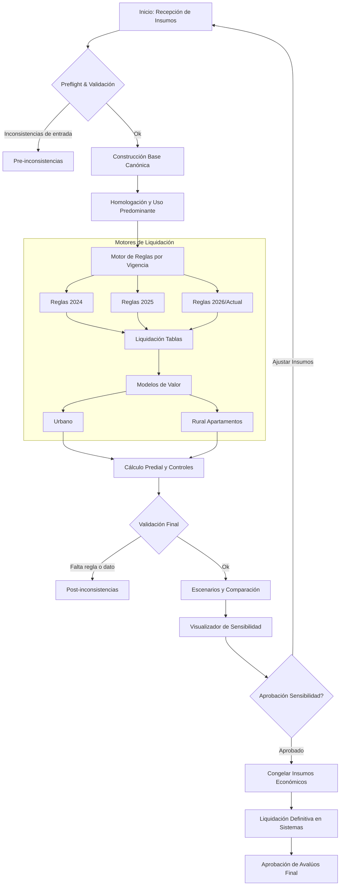

# Flujograma de Preliquidación y Liquidación

Este documento describe el flujo actual ajustado para el proceso de sensibilidad y liquidación final de la base catastral.

## Flujo Objetivo

## Diccionario de Variables a Conservar (Matriz)

*Las siguientes variables no deben ser renombradas en ninguna etapa del pipeline para garantizar la compatibilidad con las fuentes de Sistemas:*

- `ID_PREDIO`
- `ZHF`
- `LATITUDE`
- `LONGITUDE`
- `AVALPRED` (o variantes con vigencia `AVALPRED_2025`, `AVAL_CAT_2026`)
- `VM2_COM_*` y `VM2_CAT_*`
- Constantes de destinos `DESTINOS_MODELO_*` (Usos 001, 028, 034 condición 9)

